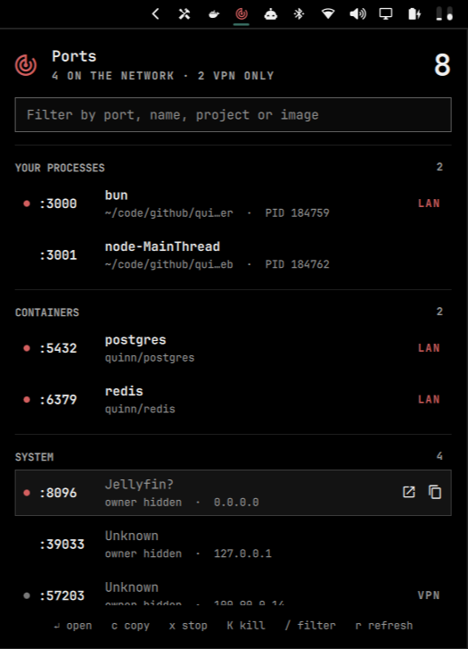

# Ports

What is listening on this machine, who owns it, and how far it reaches — from
a radar icon in the Omarchy bar.



## Install

```bash
omarchy plugin add https://github.com/RohitKaushal7/omarchy-ports --enable
```

The icon lands in the right section of the bar. To move it:

```bash
omarchy bar move dev.reuk.ports --after <widget-id>
```

### Requirements

- Omarchy 4 or newer
- `/usr/bin/python3`, 3.9 or newer — standard library only
- `ss`, from `iproute2`
- `xdg-open` (`xdg-utils`) and `wl-copy` (`wl-clipboard`), for the open and copy actions
- Optional: the Docker CLI with access to the Docker daemon, to name published container ports

Nothing is downloaded at runtime, and nothing is written outside the plugin
folder.

## Remove

```bash
omarchy plugin remove dev.reuk.ports
```

This deletes the plugin folder and its bar entry. Ports keeps no other state.

## The panel

Listeners are grouped by owner:

- **Your processes** — sockets opened by your own user. Open, copy, terminate
  or kill them.
- **Containers** — ports published by running Docker containers, named after
  the container and its Compose project. Stop them through Docker.
- **System** — everything owned by root or another user. Read-only.

An IPv4 and IPv6 bind of the same port by the same owner is one row, not two.

### Reach

Every row says how far its port reaches, from its bind addresses:

| Marker | Meaning |
|---|---|
| red dot, `LAN` | reachable from the network — a wildcard or LAN address |
| grey dot, `VPN` | bound only to a Tailscale or NetBird address, or to this machine's address on a WireGuard interface |
| nothing | loopback, this machine only |

The bar icon turns red while anything is reachable from the network, or never,
if you set [`iconAlert`](#settings) to `"Never"`.

### Unnamed sockets

As a normal user, `ss` cannot say which process owns a socket that belongs to
root or another user, and on most machines that is nearly all of them. Those
rows show the service that usually uses the port, with a question mark —
`Redis?` on 6379, `Jellyfin?` on 8096 — and the tooltip says it is a guess.
About a hundred common service ports are known; development-server ports are
deliberately left out. A port published by a container is attributed to the
container instead.

## Keyboard

| Key | Action |
|---|---|
| `j` `k` / `↓` `↑` | move between rows |
| `↵` | open in the browser |
| `c` | copy the URL |
| `x` | stop the container, or terminate the process |
| `K` | force kill the process |
| `/` or a digit | filter |
| `r` | refresh |
| `Esc` | clear the filter, then close |
| `Tab` | next bar panel |

Right-click the bar icon to refresh without opening it.

## Settings

Change settings from the bar's widget settings, or with `omarchy bar set`:

```bash
omarchy bar set dev.reuk.ports iconAlert Never
omarchy bar set dev.reuk.ports hiddenNames "spotify,kdeconnectd"
omarchy bar set dev.reuk.ports showSystem false --json
```

They live in this widget's entry in `~/.config/omarchy/shell.json`, and the
panel picks up a change as soon as it is saved.

| Key | Default | What it does |
|---|---|---|
| `iconAlert` | `"Network"` | When the bar icon turns the theme's urgent colour. `"Network"`: something is reachable from the network. `"Network and VPN"`: also when something is bound only to a VPN address. `"Never"`: the icon always matches the rest of the bar. |
| `ignoredPorts` | `"53,631,5353"` | Ports and ranges to leave out, e.g. `"53,631,8000-8010"`. The default hides DNS, CUPS and mDNS. |
| `hiddenNames` | `""` | Comma-separated names to leave out, matched without regard to case against process names, container names, Compose services and guessed service names, e.g. `"spotify,kdeconnectd"`. |
| `showSystem` | `true` | List sockets owned by root or other users. `false` shows only your processes and containers. |
| `showGuesses` | `true` | Name unnamed sockets after the service that usually uses the port, as `Redis?`. `false` shows them as `Unknown`. |
| `includeDocker` | `true` | Attribute published ports to their containers and allow stopping them. `false` never runs `docker`. |
| `includeUdp` | `false` | List UDP sockets as well as TCP listeners. |
| `confirmActions` | `true` | Ask before terminating, killing or stopping. `false` acts on the first key press or click. |
| `refreshIntervalSec` | `5` | Seconds between scans, 2–120. Opening the panel always scans immediately. |

Anything left out by `ignoredPorts`, `hiddenNames` or `showSystem` is also left
out of the counts and the icon alert. The filter box in the panel only narrows
the list you are looking at.

A complete entry, with every setting at its default except the icon:

```json
{
  "id": "dev.reuk.ports",
  "iconAlert": "Never",
  "ignoredPorts": "53,631,5353",
  "hiddenNames": "",
  "showSystem": true,
  "showGuesses": true,
  "includeDocker": true,
  "includeUdp": false,
  "confirmActions": true,
  "refreshIntervalSec": 5
}
```

## How it runs

Everything runs as your user, with no elevated privileges.

- The panel starts one helper, `bin/ports.py`, as `/usr/bin/python3 -I` with
  an emptied environment: `PATH=/usr/bin:/bin` and `LC_ALL=C`, plus
  `DOCKER_HOST` when it is set. No shell is involved at any step.
- The helper reads `ss` and `/proc`, and runs `docker ps` and `docker inspect`
  when Docker support is on. It makes no network requests.
- Output from `ss` and `docker` is read up to 4 MiB and within a deadline —
  5 s for `ss`, 10 s for Docker queries, 30 s for `docker stop` — and the
  child is killed when it passes either.
- The helper prints at most 512 listeners, with every command line, path and
  image name cut at 512 characters. The panel stops a helper that prints more
  than 2 MiB, or that runs past 35 s for a scan or 45 s for an action.
- A process is only signalled if it is still the one the panel listed: owned by
  you, with the same start time. The signal goes through a pidfd opened
  *before* that check, so a recycled PID can never receive it.
- A container is only stopped if Docker still reports it running, and only by
  an id Docker itself returned.
- Open and copy pass a validated `http://address:port` URL to
  `/usr/bin/xdg-open` or `/usr/bin/wl-copy`.
- Terminate, kill and stop all ask first, with Cancel selected, unless
  `confirmActions` is turned off.

## Development

- `Panel.qml` — bar icon, popup, sections, keyboard and confirmation.
- `bin/ports.py` — `scan` prints every listener as JSON; `signal` and `stop`
  act on one. Run it directly to see what the panel sees:

  ```bash
  bin/ports.py scan | python3 -m json.tool
  ```

- `tests/` — `test_ports.py` covers parsing, grouping and output bounds from
  captured `ss` and `docker inspect` output; `test_ports_system.py` runs
  against real child processes, the real `ss`, and a stand-in `docker`.

```bash
python3 -m unittest discover -s tests
omarchy plugin validate .
```

## License

MIT — see [LICENSE](LICENSE).
